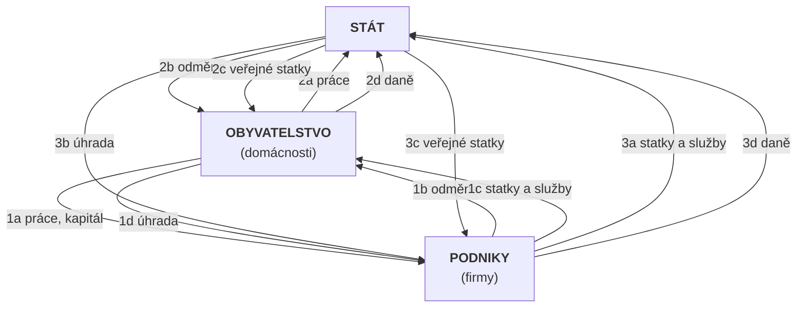

# 2. Národní hospodářství

> **Předmět:** Ekonomie  
> **Maturitní požadavky:** 2. Národní hospodářství - charakteristika, úroveň národního hospodářství, struktura národního hospodářství. Národohospodářské veličiny. Řízení národního hospodářství. Koloběh v národním hospodářství. Okolí národního hospodářství.  
> **Zdrojové PDF:** [2 Narodni hospodarstvi.pdf](../zdroje/pdf/2%20Narodni%20hospodarstvi.pdf)  
> **Stav pokrytí:** Plně pokryto. PDF obsahuje všechny body maturitního zadání a navíc zahrnuje i problematiku hospodářského cyklu (která je v maturitním zadání zařazena u tématu č. 4 Poruchy trhu). Podrobnější rozbor národohospodářských veličin (HDP, inflace, nezaměstnanost, platební bilance) odkazuje na téma č. 4.

---

## Charakteristika národního hospodářství

- Je to souhrn hospodářských činností v určitém státě, kterých se účastní podnikatelské subjekty i občané.
- Jde o souhrn všech subjektů, tzn. **domácnosti, firmy a stát**.
- Jde o složitý systém tvořený strukturami, který se musí chovat podle platných právních norem v daném státě.

### Subjekty národního hospodářství
- **Domácnosti** – nabízejí výrobní faktory, nakupují statky a služby.
- **Firmy** – nakupují výrobní faktory, prodávají statky a služby.
- **Stát** – nakupuje výrobní faktory, nabízí výrobní faktory, nakupuje a prodává statky a služby, reguluje trh.

Výkonnost národního hospodářství zjišťujeme pomocí **makroekonomických ukazatelů** (HDP, nezaměstnanost, inflace, platební bilance, národní důchod).

---

## Úroveň národního hospodářství

Je to míra, do které je národní hospodářství schopno uspokojovat potřeby společnosti.

**Úroveň národního hospodářství ovlivňují 3 základní činitelé:**
1. **přírodní bohatství** – nerostné suroviny
2. **národní bohatství** – vše, co předchozí generace vybudovaly a můžeme to používat (školy, nemocnice, hrady a zámky, …)
3. **obyvatelstvo** – počet, struktura, vzdělanost

---

## Struktura národního hospodářství

Strukturou NH rozumíme členění podle různých hledisek. NH se skládá z určitých částí (odvětví či sektorů).

### 1. Nejčastější dělení: sektorová a odvětvová struktura

#### a) Sektorová struktura NH
- **primární sektor** – jedná se o prvovýrobu (patří sem hlavně zemědělství, lesnictví, těžební průmysl a rybolov)
- **sekundární sektor** – jde o zpracovatelský průmysl, stavebnictví a výrobu energií
- **terciární sektor** – jde o všechny služby (například doprava, zdravotnictví, policie, obchodní služby atd.)
- **kvartární sektor** – jde o vědu a výzkum

#### b) Odvětvová struktura NH
- Jde o různá odvětví, která jsou si podobná svými výkony, používáním podobných materiálů či poskytováním podobných služeb.
- **Např.:** průmysl, zemědělství, doprava, stavebnictví, pojišťovnictví, školství, obchod, cestovní ruch, zdravotnictví, kultura, obrana apod.

### 2. Členění NH z hlediska financování

#### a) Ziskový sektor
- veřejný sektor
- soukromý sektor

#### b) Neziskový sektor
- veřejný sektor
- soukromý sektor

- **Ziskový (tržní) sektor** – je založen na tvorbě zisku. Subjekty jsou založeny na fungování daného trhu s jeho nabídkou a poptávkou a cenou odrážející vztahy na daném trhu.
- **Neziskový (netržní) sektor** – je založen na poskytování služeb či produkci statků, které nejsou určeny k tržní výměně, ale k uspokojování potřeb. Většinou je tedy založen na dosažení užitku. Tento sektor funguje díky přerozdělovacím procesům (čerpání fondů, dotace, transfery ze státního rozpočtu).

---

## Řízení národního hospodářství

- **Vláda ČR** – výkonný orgán, připravuje zákony (vč. státního rozpočtu)
- **Parlament ČR** – schvaluje zákony
- **Centrální banka** (ČNB)
- **Komunální orgány** – krajské, městské a obecní úřady, magistráty – vydávají vyhlášky

---

## Koloběh v národním hospodářství

V národním hospodářství probíhají různorodé činnosti, které se stále opakují. S tím je spojen neustálý pohyb – **koloběh statků a služeb, peněz a práce**, který probíhá mezi obyvatelstvem (domácnostmi), podniky a státem.

### Schéma koloběhu v národním hospodářství



| Okruh vztahů | Tok od 1. subjektu k 2. subjektu | Tok od 2. subjektu k 1. subjektu |
| :--- | :--- | :--- |
| **1. Obyvatelstvo (domácnosti) ↔ Podniky (firmy)** | **1a** práce, kapitál (Domácnosti → Podniky)<br>**1d** úhrada (Domácnosti → Podniky) | **1b** odměna (Podniky → Domácnosti)<br>**1c** statky a služby (Podniky → Domácnosti) |
| **2. Obyvatelstvo (domácnosti) ↔ Stát** | **2a** práce (Domácnosti → Stát)<br>**2d** daně (Domácnosti → Stát) | **2b** odměna (Stát → Domácnosti)<br>**2c** veřejné statky (Stát → Domácnosti) |
| **3. Podniky (firmy) ↔ Stát** | **3a** statky a služby (Podniky → Stát)<br>**3d** daně (Podniky → Stát) | **3b** úhrada (Stát → Podniky)<br>**3c** veřejné statky (Stát → Podniky) |

---

## Okolí národního hospodářství

Národní hospodářství každého státu má určité vztahy ke svému okolí. Na jedné straně je NH tímto okolím ovlivňováno, na druhé straně toto okolí samo ovlivňuje. Také ČR se tedy zapojuje do činnosti různých světových organizací.

- **Mezinárodní měnový fond (MMF)** – vznikl v roce 1945, jsme jedním ze zakládajících členů. Hlavní úlohou je prevence a bedlivé sledování vývoje jednotlivých národních ekonomik.
- **Světová banka** – vznikla v roce 1944. Byla určena na obnovu a rozvoj válkou zničených zemí Evropy. Poskytuje pomoc rozvojovým zemím (klientské země). ČR v roce 2005 vystoupila ze skupiny klientských zemí mezi země vyspělé a finanční podporu od Světové banky už nečerpá.
- **OECD (Organizace pro hospodářskou spolupráci a rozvoj)** – posláním je pomáhat k dalšímu ekonomickému rozvoji, potlačení nezaměstnanosti, stabilizaci a rozvoji mezinárodních finančních trhů. ČR je členem od roku 1995.
- **Evropská unie (EU)** – seskupení států (celkem 27). ČR je členem od 1. května 2004. Cílem je vytvoření společného trhu, hospodářské a měnové unie, podpora rozvoje a růstu hospodářství, zaměstnanosti, konkurenceschopnosti, zlepšování životní úrovně a kvality životního prostředí.

---

## Národohospodářské veličiny

- Výkonnost národního hospodářství zjišťujeme pomocí tzv. **makroekonomických ukazatelů** (**HDP**, **nezaměstnanost**, **inflace**, **platební bilance**, **národní důchod**).
- Nejvýznamnějším ukazatelem je **Hrubý domácí produkt (HDP)**. Využívá se k porovnání v čase (jak daný stát hospodařil) či prostoru (v porovnání s jinými státy).
- *(Více o makroekonomických ukazatelích – viz problematika [4. Poruchy trhu](./04-poruchy-trhu.md)).*

### Magický čtyřúhelník

Výše uvedené ukazatele spolu tvoří tzv. **„Magický čtyřúhelník“** – obrazec, z něhož se dá poznat, jak je daná ekonomika stabilní a výkonná. Pokud je ekonomika státu v ideálním stavu, podobá se její obrazec velkému pravoúhlému čtyřúhelníku (kosočtverci). Pokud daná země trpí určitými ekonomickými neduhy, je její obrazec různě zdeformovaný.

```
                         HDP %
                          |
                       10 +
                          |
                        5 +
                         /|\
                        / | \
                       /  0  \
                      /   |   \
                     /   -5    \
--------------------+-----+-----+-----+-----+-----+--------------------
míra               15    10     5     |    -5     0     5   platební bilance
nezaměstnanosti %                      \                    % z HDP
                                        \ 15
                                         \ |
                                          \10
                                           \|
                                            5
                                            |
                                        inflace %
```

*(Pozn.: Na ose vlevo jsou vynášeny hodnoty míry nezaměstnanosti 5 %, 10 %, 15 % směrem ke středu; na horní ose HDP -5 %, 0 %, 5 %, 10 % směrem nahoru; na pravé ose platební bilance -5 %, 0 %, 5 % z HDP směrem doprava; na dolní ose míra inflace 15 %, 10 %, 5 % směrem dolů.)*

**Ideální magický čtyřúhelník je, když:**
- **míra inflace** je **2 %**
- **míra nezaměstnanosti** je **cca 5 %**
- **růst HDP** je **3 %**
- **platební bilance** je **vyrovnaná (saldo 0 %)**

---

## Hospodářský cyklus

- Hospodářský cyklus nám ukazuje, jak se vyvíjí ekonomika dané země v čase.
- Jde vlastně o porovnání **potenciálního** a **reálného (skutečného) HDP**, o kolísání reálného produktu okolo potenciálního.
- **Potenciální produkt** je produkt vytvořený za podmínek plného využití pracovních a ostatních výrobních zdrojů, které má ekonomika k dispozici.

### Graf hospodářského cyklu

```
HDP ^
    |                                     ___
    |          vrchol                    /   \
    |           ___                     /     \   potenciální HDP
    |          /   \                   /       \ - - - - - - - - -
    |  expanze/     \                 /    . '  |
    |        /       \   recese      / . '      |
    |       /    . '  \          . '/           |
    |      / . '       \     . '   /            | reálný HDP
    |  . '/             \___/                   |
    |                    dno
    +------------------------------------------------------> čas (t)
```

### 4 fáze hospodářského cyklu

1. **expanze (růst)** – roste agregátní poptávka (více se prodává), roste výroba, rostou investice, snižuje se nezaměstnanost. Produkt roste alespoň ve dvou po sobě jdoucích obdobích.
2. **vrchol** – skutečný produkt dosahuje svého maxima, ekonomice se velmi daří, velká poptávka, hodně se vyrábí, investuje.
3. **recese (pokles)** – výrazný pokles agregátní poptávky, klesají nákupy spotřebních statků, klesají investice, omezuje se výroba, roste nezaměstnanost. Produkt klesá alespoň ve dvou po sobě jdoucích obdobích. Pokud recese trvá dlouhou dobu, jedná se o tzv. **depresi**.
4. **dno** – skutečný produkt dosahuje svého minima, téměř žádné investice, malá poptávka.
