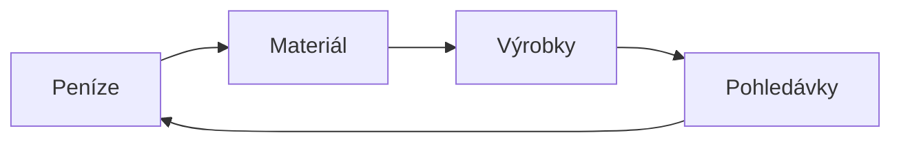

# 11. Dlouhodobý majetek podniku

> **Předmět:** Ekonomie  
> **Maturitní požadavky:** 11. Dlouhodobý majetek podniku - dlouhodobý hmotný majetek, dlouhodobý nehmotný majetek, dlouhodobý finanční majetek. Způsoby pořízení dlouhodobého majetku. Uvedení do užívání. Oceňování dlouhodobého majetku. Způsoby vyřazení dlouhodobého majetku. Odpisovaný a neodpisovaný majetek.  
> **Zdrojové PDF:** [11 Majetek podniku.pdf](../zdroje/pdf/11%20Majetek%20podniku.pdf)  
> **Stav pokrytí:** Částečně pokryto (téměř kompletní + přesah do tématu 12) – PDF podrobně pokrývá dlouhodobý hmotný, nehmotný a finanční majetek, způsoby pořízení, oceňování, vyřazení, opotřebování, účetní a daňové odpisy i odpisovaný a neodpisovaný majetek. Navíc obsahuje kapitolu o oběžném (krátkodobém) majetku. V PDF chybí pouze samostatné rozvedení pojmu **„Uvedení do užívání“** (podmínky zařazení majetku do užívání, protokol o zařazení do užívání).

---

## Majetek podniku – vymezení

Každý podnikatel, který chce podnikat, musí mít kromě povolení i určité potřebné prostředky. Tyto prostředky obecně označujeme jako **majetek podniku**. Jde tedy o **souhrn všech majetkových hodnot (věcí, práv a hodnot), ocenitelných penězi, které slouží k podnikání a jsou majetkem podnikatele**.

Rozeznáváme dva základní typy majetku – **dlouhodobý** a **krátkodobý (oběžný)**.

---

## Dlouhodobý majetek

Jde o majetek, který slouží podniku delší dobu (**déle než 1 rok**), nemění svou podobu a postupně se opotřebovává.

Dlouhodobý majetek se dále dělí na tři skupiny – **hmotný**, **nehmotný** a **finanční**.

### 1) Hmotný dlouhodobý majetek
Hmotný dlouhodobý majetek musí mít **vstupní cenu minimálně 80 000 Kč** a již zmíněnou dobu použitelnosti delší jak 1 rok. Dlouhodobý majetek účetní jednotka odepisuje (**kromě půdy, uměleckých děl a sbírek** – to je *neodpisovaný majetek*).

**Hmotný dlouhodobý majetek zahrnuje:**
- pozemky, budovy, haly a stavby
- samostatné movité věci a soubory věcí (například automobil, stroj aj.)
- pěstitelské celky trvalých porostů (jedná se o vinice, sady atd.)
- základní stádo a tažná zvířata, dostihoví a plemenní koně
- umělecká díla a sbírky
- technické zhodnocení s celkovou cenou alespoň 80 000 Kč (rekonstrukce budovy, přístavby apod.)
- **drobný hmotný dlouhodobý majetek** – v případě, že firma rozhodne o zařazení, v opačném případě ho může zařadit do oběžného majetku. Jde o majetek, jehož **pořizovací cena je nižší než 80 000 Kč**.

### 2) Nehmotný dlouhodobý majetek
Doba používání je opět **1 rok a více**. Hodnotovou hranici pro dlouhodobý nehmotný majetek si určuje účetní jednotka sama, zákon již minimální pořizovací cenu od roku 2021 nestanoví.

**Řadíme sem hlavně:**
- software
- ocenitelná práva – patenty, licence, autorská práva
- know-how
- zřizovací výdaje (výdaje na založení podniku) – soudní a notářské poplatky atd.
- ochranné známky

### 3) Finanční dlouhodobý majetek (finanční investice)
Jde o majetek, který je pořizován za účelem dosažení výnosů z něho, popř. za účelem ovládání jiných podniků. Finanční dlouhodobý majetek podnik vlastní **déle než 1 rok**. Jedná se například o **akcie, obligace, vkladové listy** apod.

---

## Pořízení dlouhodobého majetku

Existuje několik způsobů, jak může podnik získat majetek:
- **Nákup** – nejběžnější způsob obstarání majetku. Nakoupit můžeme jak nový, tak i použitý dlouhodobý majetek.
- **Vlastní výroba** – majetek si firma pořídí ve vlastní režii. Stavební firma si například může postavit vlastní kanceláře, počítačová firma si sestaví PC apod.
- **Vklad majetku společníky** – společník vloží do firmy nepeněžitý vklad.
- **Převod z osobního užívání (vlastnictví)** – podnikatel může vložit svůj osobní majetek do své firmy.
- **Darování** – jde o bezúplatné nabytí majetku.
- **Finanční leasing** – jedná se o pronájem majetku s jeho následnou koupí.

---

## Oceňování dlouhodobého majetku

- **Pořizovací cena** – zahrnuje vedle vlastní ceny majetku také náklady související s pořízením (např. doprava, montáž, odměny za zprostředkování atd.).
- **Cena pořízení** – cena, za kterou byl majetek pořízen bez nákladů s jeho pořízením souvisejících.
- **Reprodukční pořizovací cena** – cena, za kterou by byl majetek pořízen v době, kdy se o něm účtuje (např. u majetku nově zjištěného či získaného darováním).
- **Vlastní náklady** – cena se stanovuje podle skutečných vlastních nákladů, které podnik vynaložil na pořízení dané věci (u majetku vytvořeného vlastní činností).

---

## Vyřazení dlouhodobého majetku

Pokud již majetek nepotřebujeme nebo je opotřebený, dochází k jeho vyřazení. Dlouhodobý majetek můžeme vyřadit následujícími způsoby:
- **Prodej** – prodej nepotřebného majetku
- **Převod do osobního užívání** – pokud podnikatel nepotřebuje majetek, může ho převést do osobního užívání
- **Darování** – bezúplatný převod
- **Likvidace** – odvoz do šrotu, demolice atd.
- **Manko, škoda**

---

## Opotřebování a odepisování dlouhodobého majetku

Každý dlouhodobý majetek se postupem času **opotřebovává**, čímž se **snižuje jeho hodnota (výjimku tvoří umělecká díla a sbírky, kdy jejich hodnota s časem roste)**. K opotřebení dochází, i když dlouhodobý majetek nepoužíváme.

**Rozlišujeme tedy 2 typy opotřebení:**
1. **Fyzické** – dochází k němu při používání majetku (opotřebení jednotlivých částí a součástek), ale i při jeho nepoužívání (například koroze strojů).
2. **Morální** – nesouvisí s používáním majetku. Jde o technické a technologické zastarání (například po určité době se na trhu objeví stroj, který je dokonalejší).

### Odpisy, oprávky a zůstatková cena
Opotřebení dlouhodobého majetku vyjadřují **odpisy**. Základem je to, že vstupní cena majetku se pravidelně snižuje o určitou částku.
- **Oprávky** = souhrn těchto odpisů za určitou dobu (většinou 1 rok).
- **Zůstatková cena** = cena, která se snížila o odpisy (oprávky).

Odpisy pomáhají rozložit náklady pořízeného majetku na více účetních období, podnikatelé tak lépe rozkládají své daňové povinnosti a zvyšují přehlednost finančního hospodaření.

### Druhy odpisů: účetní a daňové

- **Účetní odpisy** – vyjadřují skutečnou míru opotřebení majetku. Jsou upraveny v Zákoně o účetnictví. Firma je nemusí používat (jen ty, které musí ověřovat závěrku auditorem). Tyto odpisy slouží k přehledu o skutečné výši hodnoty majetku a jeho opotřebení v důsledku užívání nebo zaostávání po technické stránce.
- **Daňové odpisy** – tyto odpisy musí používat každý podnik. Způsoby odepisování stanovuje Zákon o dani z příjmu. Jejich výše se uznává jako nákladová položka při zjišťování hospodářského výsledku.

Při výpočtu daňových odpisů se podnik může rozhodnout, zda bude majetek odepisovat **lineárně (rovnoměrně)**, nebo **degresivně (zrychleně)** – metodu však nemůže během odepisování měnit.

### Odpisové skupiny

Majetek podniku je při odepisování rozdělen do **6 odpisových skupin**. Jednotlivé skupiny se liší dobou odepisování.

| Odpisová skupina | Příklad majetku | Doba odpisování |
| :---: | :--- | :---: |
| **1** | počítače, kanc. stroje | 3 roky |
| **2** | os. automobily | 5 let |
| **3** | lodě, lokomotivy | 10 let |
| **4** | věže, komíny | 20 let |
| **5** | silnice, budovy | 30 let |
| **6** | hotely, školy | 50 let |

### Rovnoměrné (lineární) odepisování

Pro každou odpisovou skupinu je stanovena roční odpisová sazba (jiná sazba je pro první rok odepisování a jiná pro ostatní roky).

| Odpisová skupina | V prvním roce odpisování (%) | V dalších letech odpisování (%) | Pro zvýšenou vstupní cenu (%) |
| :---: | :---: | :---: | :---: |
| **1** | 20 | 40 | 33,3 |
| **2** | 11 | 22,25 | 20 |
| **3** | 5,5 | 10,5 | 10 |
| **4** | 2,15 | 5,15 | 5,0 |
| **5** | 1,4 | 3,4 | 3,4 |
| **6** | 1,02 | 2,02 | 2,0 |

Roční odpis se následně vypočítá podle následujícího vzorce:

$$\text{Roční odpis} = \frac{\text{vstupní cena} \times \text{roční odpisová sazba}}{100}$$

### Zrychlené (degresivní) odepisování

Pro výpočet se používá koeficient a liší se i postup výpočtu v prvním roce a v dalších letech. **Nejvyšší odpis je u tohoto odepisování ve druhém roce.**

| Odpisová skupina | V prvním roce odpisování | V dalších letech odpisování | Pro zvýšenou vstupní cenu |
| :---: | :---: | :---: | :---: |
| **1** | 3 | 4 | 3 |
| **2** | 5 | 6 | 5 |
| **3** | 10 | 11 | 10 |
| **4** | 20 | 21 | 20 |
| **5** | 30 | 31 | 30 |
| **6** | 50 | 51 | 50 |

**Vzorce pro výpočet:**

$$\text{Roční odpis v 1. roce} = \frac{\text{vstupní cena}}{\text{koeficient pro 1. rok}}$$

$$\text{Roční odpis v dalších letech} = \frac{2 \times \text{zůstatková cena}}{\text{koeficient pro další roky} - \text{počet let dosavadního odepisování}}$$

---

## Oběžný (krátkodobý) majetek

Oběžný majetek je takový majetek, který firma používá **maximálně 1 rok**, mění svou podobu a často se spotřebovává jednorázově. Tento majetek se nazývá oběžný podle toho, že je vlastně neustále v pohybu (oběhu). V podniku se vyskytuje v různých formách a jedna forma přechází v druhou – za peníze nakoupí firma materiál, ze kterého vyrobí výrobky. Ty následně prodá, tzn. má pohledávku a uhrazením pohledávky získá znovu peníze. Do oběžného majetku tedy řadíme **zásoby, pohledávky a finanční majetek**.

### 1) Zásoby

- **Materiál** – takový oběžný majetek, ze kterého vznikají výrobky. Patří sem ale i takový majetek, jenž výrobek přímo netvoří, ale řadíme ho sem, aby se zjednodušila evidence. Do materiálu můžeme zařadit hlavně:
  - *základní materiál* – tvoří základ (podstatu) výrobku – např. při výrobě šatů bude základním materiálem látka, u knihy papír, u dřevěného stolu dřevo apod.
  - *pomocný materiál* – slouží k doplnění výrobku – u našich příkladů půjde např. o niti a knoflíky, lepidlo apod.
  - *provozovací látky* – nepoužívají se přímo k výrobě výrobků, ale jsou potřeba k provozu podniku – např. čisticí prostředky, oleje atd.
  - *náhradní díly* – jde o výrobky, které slouží k opravám
  - *obaly*
- **Výrobky** – pokud mluvíme o výrobku, mluvíme o hotovém produktu. Může se jednat o:
  - *spotřební statky* – slouží k přímému užívání (televizor, nábytek, potraviny apod.)
  - *kapitálové statky* – jde o výrobky, které slouží k další výrobě jiných statků a služeb (např. mouka v pekárně, soustruh ve výrobním závodu apod.)
- **Zboží** – statky nakoupené za účelem dalšího prodeje v nezměněné podobě.
- **Nedokončená výroba a polotovary** – jedná se o rozpracované výrobky, které ale ještě nejsou hotovými výrobky.

Jak jsme si řekli již dříve, můžeme do oběžného majetku (zásob) zařadit případně i **drobný hmotný dlouhodobý majetek**. Záleží jen na organizaci, zda ho zařadí do hmotného dlouhodobého majetku, nebo do oběžného.

### 2) Pohledávky
Pohledávku můžeme charakterizovat jako **určitý nárok na zaplacení**. Vznikají nejčastěji v rámci dodavatelsko-odběratelských vztahů.

### 3) Finanční majetek
Finančním majetkem u oběžného majetku myslíme zejména **hotové peníze a peníze na účtech**. Můžeme sem ale zařadit i **krátkodobé cenné papíry či ceniny** (stravenky, kolky, poštovní známky apod.).
