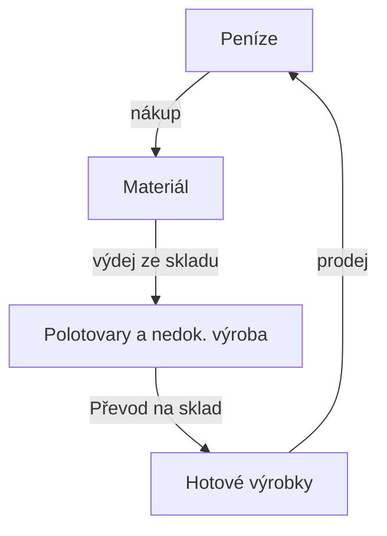

# 12. Zásobování podniku, oběžný majetek

> **Předmět:** Ekonomie  
> **Maturitní požadavky:** 12. Zásobování podniku, oběžný majetek - dělení oběžného majetku, počet obrátek, doba obratu zásob. Metoda JUST IN TIME. Zásady racionálního zásobování, metoda ABC, pilový diagram. Logistika.  
> **Zdrojové PDF:** [12 Zásobování podniku.pdf](../zdroje/pdf/12%20Zásobování%20podniku.pdf)  
> **Stav pokrytí:** Plně pokryto – PDF obsahuje veškeré body z maturitního zadání (dělení oběžného majetku, ukazatele oběhu zásob, metodu Just in Time, zásady racionálního zásobování, metodu ABC, pilový diagram včetně druhů zásob i logistiku).

---

## Oběžný (krátkodobý) majetek

Oběžný majetek je takový majetek, který firma používá **maximálně 1 rok**, mění svou podobu a často se spotřebovává jednorázově. Tento majetek se nazývá oběžný podle toho, že je vlastně neustále v pohybu (oběhu). V podniku se vyskytuje v různých formách a jedna forma přechází v druhou – za peníze nakoupí firma materiál, ze kterého vyrobí výrobky. Ty následně prodá, tzn. má pohledávku, a uhrazením pohledávky získá znovu peníze. **Do oběžného majetku tedy řadíme zásoby, pohledávky a finanční majetek.**

### Koloběh oběžného majetku



### 1) Zásoby

* **Materiál** – takový oběžný majetek, ze kterého vznikají výrobky. Patří sem ale i takový majetek, jenž výrobek přímo netvoří, ale řadíme ho sem, aby se zjednodušila evidence. Do materiálu můžeme zařadit hlavně:
  * *základní materiál* – tvoří základ (podstatu) výrobku – např. při výrobě šatů bude základním materiálem látka, u knihy papír, u dřevěného stolu dřevo apod.
  * *pomocný materiál* – slouží k doplnění výrobku – u našich příkladů půjde např. o niti a knoflíky, lepidlo apod.
  * *provozovací látky* – nepoužívají se přímo k výrobě výrobků, ale jsou potřeba k provozu podniku – např. čisticí prostředky, oleje atd.
  * *náhradní díly* – jde o výrobky, které slouží k opravám
  * *pohonné hmoty*
  * *drobné nářadí*
  * *obaly*
  * *kancelářské potřeby*
* **Výrobky** – pokud mluvíme o výrobku, mluvíme o hotovém produktu.
* **Zboží** – statky nakoupené za účelem dalšího prodeje v nezměněné podobě.
* **Nedokončená výroba a polotovary** – jedná se o rozpracované výrobky, které ale ještě nejsou hotovými výrobky.

Jak jsme si řekli již dříve, můžeme **do oběžného majetku (zásob) zařadit případně i drobný hmotný dlouhodobý majetek**. Záleží jen na organizaci, zda ho zařadí do hmotného dlouhodobého majetku, nebo do oběžného.

### 2) Pohledávky

Pohledávku můžeme charakterizovat jako určitý nárok na zaplacení. Vznikají nejčastěji v rámci dodavatelsko-odběratelských vztahů.

### 3) Finanční majetek

Finančním majetkem u oběžného majetku myslíme zejména **hotové peníze a peníze na účtech**. Můžeme sem ale zařadit i **krátkodobé cenné papíry či ceniny (stravenky, kolky, poštovní známky** apod.).

---

## Oběh zásob

Rychlost oběhu zásob měříme dvěma ukazateli:

1) **Počet obrátek**

$$\text{Počet obrátek} = \frac{\text{celková spotřeba}}{\text{průměrná zásoba}} \quad \text{nebo} \quad \frac{\text{tržby}}{\text{průměrná zásoba}}$$

2) **Doba obratu**

$$\text{Doba obratu} = \frac{365}{\text{počet obrátek}} \quad \text{nebo} \quad \frac{\text{průměrná zásoba}}{\text{tržby} / 360}$$

Pro podnikatele je důležité **zvyšovat počet obrátek a snižovat dobu obratu zásob**.

Podnikatel má 2 možnosti, jak dosáhnout vyššího počtu obrátek:
1) Zvyšovat objem výroby při zachování průměrné zásoby
2) Snižovat průměrnou zásobu při zachování celkové spotřeby za rok

---

## JUST IN TIME

**Just-in-time je metoda řízení logistiky (filozofie výroby), která organizuje logistické toky tak, aby byly minimalizovány dopravní a skladovací náklady.**

„JIT“ – ve správnou dobu, na správném místě, ve správném množství, ve správné kvalitě a ceně.

**Principem JIT je zajištění jednotlivých materiálních subdodávek do výroby tak, aby byly k dispozici přesně v ten moment, kdy mají být použity ve výrobním procesu. Minimalizuje se pohyb materiálu v podniku a výrobní linky jsou organizovány tak, aby se co nejvíce snižovaly skladovací a dopravní náklady.**

Autorem konceptu JIT je japonská automobilka Toyota. Základy JIT byly položeny již v roce 1926, ale největší rozmach nastal až v 80. letech 20. století v Japonsku a USA.

Aplikace JIT klade velmi vysoké nároky na naprosto přesnou koordinaci všech souvisejících procesů a toků a také na absolutní spolehlivost dodavatelů.

---

## Zásady racionálního zásobování

* nakupujte jen to, co potřebujete
* nakupujte jen tolik, kolik potřebujete
* zvažujte náklady na pořízení zásob a podle toho se rozhodujte, kdy a kolik nakoupit

Základním předpokladem racionálního zásobování je co nejpřesnější znalost objemu výroby, který je firma schopna na trhu prodat.

Se zásobami jsou spojené náklady a finanční zdroje, proto musíme:
1) zabezpečit plynulý chod výroby
2) zajistit, aby celkové náklady s nimi spojené byly co nejmenší

---

## Metoda ABC

ABC analýza je metoda řízení zásob (vychází z Paretova pravidla) – člení zásoby do 3 skupin:
* **A** – základní suroviny, které firma nezbytně potřebuje pro výrobu (cca 80 % hodnoty spotřeby)
* **B** – zásoby, které se snadno a rychle objednají a spotřeba není tak nákladově významná (musíme hlídat a stanovit minimální skladový limit) (cca 15 % hodnoty spotřeby)
* **C** – největší co do počtu druhů zásob, ale spotřeba vyjádřená ve financích je nejméně významná (cca 5 % hodnoty spotřeby)

---

## Pilový diagram

Představuje schéma pohybu výrobních zásob. V pilovém diagramu jsou znázorněny jednotlivé typy zásob podle jejich funkčních složek. Tato klasifikace má význam pro operativní řízení zásob. Operativní řízení zásob má zabezpečit udržování konkrétních druhů zásob v takové výši a struktuře, která odpovídá potřebám podniku.

### Znázornění pilového diagramu

*(V grafu z původního materiálu jsou zobrazeny hladiny zásob v čase od 0 do 24 dní a kolísající stav materiálu:)*
* **Příležitostná zásoba:** hladina 100 (horní hranice při mimořádném nákupu)
* **Běžná zásoba:** hladina 80 (maximální běžný stav při dodávce materiálu)
* **Technická zásoba:** hladina 30
* **Pojistná zásoba:** hladina 10 (minimální rezervní stav)
* **Materiál (skutečný stav zásob – „zuby pily“):**
  * Den 0: stav 80 $\rightarrow$ postupný pokles spotřebou na stav 30 (den 4)
  * Den 4: nová dodávka na stav 80 $\rightarrow$ pokles spotřebou na stav 10 (den 10, čerpání až k pojistné zásobě)
  * Den 10: nová dodávka na stav 80 $\rightarrow$ pokles spotřebou až na stav 0 (den 18, vyčerpání i pojistné zásoby při zpoždění dodávky)
  * Den 18: velká (příležitostná) dodávka na stav 100 $\rightarrow$ pokles spotřebou na stav 30 (den 24)

```
Množství
100 |-----------------------------------------*------------------- Příležitostná zásoba (100)
 90 |                                         |\
 80 |*---------*             *                | \----------------- Běžná zásoba (80)
 70 | \        |\            |\               |  \
 60 |  \       | \           | \              |   \
 50 |   \      |  \          |  \             |    \
 40 |    \     |   \         |   \            |     \
 30 |-----*----+----\--------+----\-----------+------*------------ Technická zásoba (30)
 20 |          |     \       |     \          |
 10 |----------+------*------+------\---------+------------------- Pojistná zásoba (10)
  0 +----------+------+------+-------*--------+-------------------
    0     2    4      8     10      14   16  18  20  22  24  Počet dní
```

### Druhy zásob
a) *běžná* – pokrývá každodenní spotřebu
b) *pojistná* – kryje zpoždění v dodávkách nebo náhlé zvýšení spotřeby v důsledku zvýšení poptávky
c) *technická* – materiál, který se musí před vstupem do výroby ještě upravit (např. sušení dřeva)
d) *příležitostná* – využití výprodejů, množstevní slev; může být ovlivněna také sezónou nebo vhodným obdobím

---

## Logistika

Samotný proces zásobování v sobě skrývá několik činností, které musí podnik provést: plánování materiálu, pořízení materiálu, skladování materiálu či výdej materiálu do výroby.

Logistika se zabývá fyzickými toky (dopravou) zboží či jiných druhů zásob od dodavatele k odběrateli (zákazníkovi) a informačními toky v písemné nebo i ústní podobě.

Logistika se zabývá toky zboží, peněz a informací jak mezi dodavatelem a odběratelem, tak také uvnitř jednotlivých firem, a to včetně různých systémů skladování zásob. Účelem celého oboru je tyto toky optimalizovat tak, aby představovaly pro firmu co nejmenší náklady.
